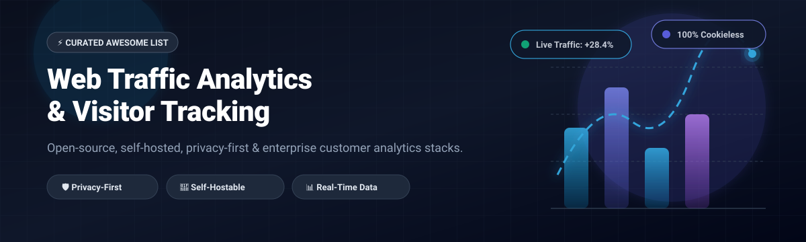

# 📊 Awesome Web Traffic Analytics & Visitor Tracking 🚀

  
  
  
  
  
  

  🎯 <b>A curated list of top Web Traffic Analytics and Visitor Tracking platforms</b> — covering open-source self-hosted solutions, privacy-friendly cookieless alternatives, and enterprise SaaS platforms for website traffic, user journey mapping, and conversion tracking.
   
  🌟 <b>Star this repo if you find it useful!</b> 🌟

---

## 📋 Table of Contents

- [📈 Sector Overview & Market Dynamics](#-sector-overview--market-dynamics)
- [🟦 SaaS / Hosted Platforms](#-saas--hosted-platforms)
- [🟩 Open-Source Software](#-open-source-software)
- [📊 Comparison at a Glance](#-comparison-at-a-glance)
- [⭐ Star History](#-star-history)
- [💖 Support & Community](#-support--community)
- [🤝 Contributing](#-contributing)
- [📄 License](#-license)

---

## 📈 Sector Overview & Market Dynamics

The global web analytics and visitor tracking market is currently estimated at approximately **$7.5B to $9.8B** and projected to expand toward **$18B to $37B** over the next decade (CAGR ~14%–18%). The market exhibits a **dual-structured landscape**: it is **moderately concentrated at the high-volume base** where tech titans (Google, Adobe) dominate overall web deployment, but **highly fragmented across privacy-first, cookieless, and specialized product analytics tiers** as strict global data privacy regulations (GDPR, CCPA, ePrivacy) and cookie deprecation drive strong demand for independent and self-hosted alternatives rather than creating a winner-take-all monopoly. 🌐🔍

---

## 🟦 SaaS / Hosted Platforms

Commercial, cloud-hosted Web Traffic Analytics and Visitor Tracking platforms sorted by company scale (market capitalization / valuation / annual revenue descending). 🏢💼

| Platform | Company Scale (Valuation / Revenue) | Starting Tier Price | Free Tier Limits / Free Trial | Primary Focus |
|:---|:---|:---|:---|:---|
| **[Google Analytics 4](https://marketingplatform.google.com/about/analytics/)** 🌐 | Alphabet Inc.: ~$2.1T Market Cap / ~$350B Rev | **$0/month** (Standard); GA4 360 starts at **$50,000/year** (~$4,166/month) | **Free forever**: Up to 10M events/month, 14-month data retention, 1M events/day BigQuery export | Industry standard web & mobile event tracking |
| **[Adobe Analytics](https://business.adobe.com/products/analytics/adobe-analytics.html)** 🏢 | Adobe Inc.: ~$220B Market Cap / ~$21B Rev | **$50,000/year** (~$4,166/month) for Select tier | **Free trial only**: No permanent free tier; bespoke 30-day guided proof-of-concept (POC) via enterprise sales | Complex enterprise multi-channel journey attribution |
| **[Mixpanel](https://mixpanel.com)** 📈 | ~$1.05B Valuation / ~$170M–$210M ARR | **$0/month** (Growth plan scales beyond 1M events; entry paid tier starts at $0 base + usage) | **Free forever**: Up to 1,000,000 events/month, unlimited team seats, 10,000 session replays/month, 5 saved reports | Product analytics, behavioral funnels & retention |
| **[Clicky](https://clicky.com)** ⏱️ | Roxr Software Ltd.: Bootstrapped SMB (~$2M–$5M Est. ARR) | **$9.99/month** (Pro plan, up to 10 sites & 30,000 daily pageviews) | **Free forever**: 1 site, 3,000 pageviews/day, 30 days history; plus **21-day full-feature free trial** (up to 3 sites & 1M daily views) | Real-time traffic monitoring, heatmaps & uptime alerts |
| **[Fathom Analytics](https://usefathom.com)** 🛡️ | Conva Ventures Inc.: Bootstrapped (~$2M–$3M ARR) | **$15/month** (Up to 100,000 monthly pageviews, up to 50 sites) | **Free trial only**: 7-day free trial (credit card required, cancel anytime); no permanent free tier | Cookieless, privacy-first EU-compliant web metrics |
| **[Simple Analytics](https://simpleanalytics.com)** 🔒 | Bootstrapped Open Startup (~$500K–$600K ARR) | **$20/month** (Starter tier for up to 100,000 monthly pageviews) | **Free forever**: Up to 5 websites, unlimited pageviews under fair use, 1 month history (requires public badge); plus **14-day free trial** for paid plans | Zero-cookie privacy analytics with EU data residency |

---

## 🟩 Open-Source Software

Self-hosted, community-driven Web Traffic Analytics tools and visitor tracking platforms. Sorted by GitHub Stars_Count (descending). Each Stars_Badge links directly to that repository's stargazers page. 💻✨

### 1. [PostHog](https://github.com/PostHog/posthog) 🦔 
- **Stack:** Python / ClickHouse / PostgreSQL / Redis | **License:** MIT (core) 📜
- **Overview:** An all-in-one product analytics suite combining web traffic analytics, session recording, feature flags, A/B experimentation, heatmaps, and a data warehouse on a single ClickHouse event database.
- **Best for:** Product and engineering teams wanting analytics, session replay, and feature flags in a single platform. 🎯

### 2. [Umami](https://github.com/umami-software/umami) 🍣 
- **Stack:** Node.js / Next.js / PostgreSQL / MySQL | **License:** MIT 📜
- **Overview:** A clean, fast, privacy-focused open-source analytics tool that does not use cookies, collect personal data, or track users across websites. Ships with a lightweight script (<3KB) and an intuitive single-page dashboard.
- **Best for:** Webmasters and developers seeking a lightweight, modern, cookie-free Google Analytics alternative. 🚀

### 3. [Plausible Analytics](https://github.com/plausible/analytics) 📊 
- **Stack:** Elixir / Phoenix / ClickHouse / PostgreSQL | **License:** AGPL-3.0 📜
- **Overview:** Lightweight (<1KB script), cookie-free, privacy-compliant web analytics. Fully GDPR, CCPA, and PECR compliant out of the box without requiring cookie consent banners.
- **Best for:** Privacy-conscious sites wanting essential traffic metrics without bloated tracking scripts or compliance headaches. 🛡️

### 4. [Matomo](https://github.com/matomo-org/matomo) 🔍 
- **Stack:** PHP / MySQL / MariaDB | **License:** GPL-3.0 📜
- **Overview:** The most comprehensive and mature self-hosted open-source analytics platform. Provides full Google Analytics feature parity including ecommerce tracking, goal conversions, custom events, heatmaps, tag management, and server log file import.
- **Best for:** Organizations needing full data sovereignty, enterprise-grade auditability, and deep GA-level behavioral metrics. 🏛️

### 5. [GoAccess](https://github.com/allinurl/goaccess) ⚡ 
- **Stack:** C / Ncurses | **License:** MIT 📜
- **Overview:** An ultra-fast, real-time web log analyzer and interactive terminal viewer that also outputs interactive HTML reports. Parses Apache, Nginx, Amazon S3, CloudFront, and Caddy access logs on the fly without running any client-side JavaScript.
- **Best for:** DevOps, sysadmins, and privacy purists wanting zero client-side tracking and instant server log analysis. 🖥️

### 6. [Rybbit](https://github.com/rybbit-io/rybbit) 🐸 
- **Stack:** Node.js / ClickHouse / Docker | **License:** AGPL-3.0 📜
- **Overview:** A modern open-source web analytics tool built on top of ClickHouse for lightning-fast aggregation on heavy traffic volume. Features quick Docker Compose deployment with automated SSL via Caddy.
- **Best for:** High-traffic sites requiring a modern, responsive dashboard with fast ClickHouse columnar queries. 🏎️

### 7. [Countly](https://github.com/Countly/countly-server) 📱 
- **Stack:** Node.js / MongoDB | **License:** AGPL-3.0 📜
- **Overview:** Enterprise-grade product analytics and user tracking platform for web, mobile, and IoT devices. Tracks user journeys, crashes, attribution, push notifications, and in-app behaviors.
- **Best for:** Multi-platform web, mobile app, and IoT visitor and user journey analytics. 🌐

### 8. [Shynet](https://github.com/milesmcc/shynet) 🤫 
- **Stack:** Python / Django / PostgreSQL | **License:** Apache-2.0 📜
- **Overview:** Modern, privacy-friendly, and detailed web analytics that works without cookies, fingerprinting, or client-side JavaScript (via tracking pixels). Provides clean referral and visitor statistics.
- **Best for:** Non-intrusive tracking that works even on script-blocked or headless environments. 🕵️

### 9. [Tianji](https://github.com/msgbyte/tianji) 🛰️ 
- **Stack:** Node.js / TypeScript / PostgreSQL | **License:** AGPL-3.0 📜
- **Overview:** An all-in-one web analytics platform, uptime monitor, and server status tracker. Unifies visitor analytics, page speed monitoring, and operational status in a single dashboard.
- **Best for:** Site operators and indie developers wanting website visitor tracking combined with uptime monitoring. ⏱️

### 10. [Open Web Analytics (OWA)](https://github.com/Open-Web-Analytics/Open-Web-Analytics) 🌐 
- **Stack:** PHP / MySQL | **License:** GPL-2.0 📜
- **Overview:** A venerable open-source web analytics framework providing click heatmaps, user session recording, DOM click streams, ecommerce goal tracking, and WordPress integration.
- **Best for:** WordPress users and PHP/MySQL-hosted web environments wanting native analytics integration. 🧩

### 11. [Swetrix](https://github.com/Swetrix/swetrix) 📈 
- **Stack:** TypeScript / Node.js / ClickHouse / Redis | **License:** AGPL-3.0 📜
- **Overview:** A cookieless, lightweight web analytics platform offering live visitor metrics, performance monitoring, error tracking, and custom conversion funnel tracking.
- **Best for:** Developers looking for privacy-first analytics with integrated front-end performance and error tracking. 🛠️

### 12. [ZerØ Analytics](https://github.com/ncarlier/za) ⭕ 
- **Stack:** Go | **License:** Apache-2.0 📜
- **Overview:** A minimalist, single-binary analytics server that ingests page views, uncaught errors, and custom events without personal data, routing events directly into Prometheus, Loki, or Elasticsearch.
- **Best for:** Infrastructure and SRE teams wanting to funnel web analytics directly into existing Grafana/Prometheus observability pipelines. 🔭

---

## 📊 Comparison at a Glance

| Software | Model | Stack / Tech | Self-Hosted | Free Tier Limits | Privacy / Cookieless | Primary Use Case |
|:---|:---|:---|:---:|:---|:---:|:---|
| **Google Analytics 4** | Commercial SaaS | Google Cloud | ❌ | Free up to 10M events/month | ❌ | Universal standard & ad attribution 🌐 |
| **Adobe Analytics** | Commercial SaaS | Adobe Experience Platform | ❌ | Demo / 30-day trial only | ❌ | Enterprise omni-channel attribution 🏢 |
| **Mixpanel** | Commercial SaaS | Proprietary Columnar | ❌ | Free up to 1M events/month | ❌ | Deep product funnels & cohort retention 📈 |
| **Clicky** | Commercial SaaS | Proprietary | ❌ | Free 1 site (3K pageviews/day) + 21-day trial | ⚠️ Optional | Real-time traffic, heatmaps & uptime ⏱️ |
| **Fathom Analytics** | Commercial SaaS | Cloudflare / AWS | ❌ | 7-day free trial | ✅ Cookieless | Simplified, EU-routed privacy tracking 🛡️ |
| **Simple Analytics** | Commercial SaaS | EU Cloud | ❌ | Free 5 sites (badge) + 14-day trial | ✅ Zero cookies | Strict privacy & zero personal data collection 🔒 |
| **PostHog** | Open Source / Cloud | ClickHouse / Python | ✅ | Self-hosted free / Cloud 1M events free | ⚙️ Configurable | All-in-one product analytics & replay 🦔 |
| **Umami** | Open Source / Cloud | Node.js / PostgreSQL | ✅ | Self-hosted free / Cloud 100K events free | ✅ Cookieless | Clean, modern Google Analytics replacement 🍣 |
| **Plausible Analytics** | Open Source / Cloud | Elixir / ClickHouse | ✅ | Self-hosted free (CE) / Cloud 30-day trial | ✅ Cookieless | Lightweight, compliant traffic metrics 📊 |
| **Matomo** | Open Source / Cloud | PHP / MySQL | ✅ | Self-hosted unlimited free / Cloud 21-day trial | ✅ Cookieless mode | Full Google Analytics parity & data sovereignty 🔍 |
| **GoAccess** | Open Source | C / CLI / Web | ✅ | 100% Free / Open Source | ✅ Zero-client | Instant web server access log analysis ⚡ |
| **Rybbit** | Open Source / Cloud | ClickHouse / Node.js | ✅ | Self-hosted free / Cloud 7-day trial | ⚙️ Configurable | Scalable columnar web visitor analytics 🐸 |
| **Countly** | Open Source / Cloud | Node.js / MongoDB | ✅ | Self-hosted Community Edition free | ✅ Built-in | Multi-platform web, mobile & IoT analytics 📱 |
| **Shynet** | Open Source | Python / Django | ✅ | 100% Free / Open Source | ✅ Cookieless | Minimalist tracking via JS or 1x1 image pixel 🤫 |
| **Tianji** | Open Source / Cloud | Node.js / PostgreSQL | ✅ | Self-hosted free / Cloud free tier | ✅ Cookieless | Unified analytics, uptime & server status 🛰️ |
| **Open Web Analytics** | Open Source | PHP / MySQL | ✅ | 100% Free / Open Source | ✅ Self-hosted | Self-hosted clickstreams, heatmaps & WordPress 🌐 |
| **Swetrix** | Open Source / Cloud | TypeScript / ClickHouse | ✅ | Self-hosted free / Cloud 5K events free | ✅ Cookieless | Analytics with performance & error monitoring 📈 |
| **ZerØ Analytics** | Open Source | Go | ✅ | 100% Free / Open Source | ✅ Zero-data | Observability pipeline (Loki/Prometheus) integration ⭕ |

---

##  Star History

---

## 💖 Support & Community

Thank you so much for exploring this curated collection of web traffic analytics and visitor tracking tools! 🌟  
Building and maintaining open-source lists takes time and care. If you find this repository valuable:

- ⭐ **Star this repository** to help others discover it!
- 🍴 **Fork and share** it with your engineering and analytics teams!
- ☕ **Buy me a coffee / Sponsor**: If you'd like to back continued development, consider sponsoring via the [GitHub Sponsors Dashboard](https://github.com/sponsors/ishandutta2007). Your support is greatly appreciated! 🙌

---

## 🤝 Contributing

Contributions are always welcome! 💡 If you know of an open-source Web Traffic Analytics or Visitor Tracking tool that should be listed here, please open a pull request with:

- 🏷️ Project name and repository URL
- 📝 Brief description (1–2 sentences)
- ⚙️ Technology stack and license
- 💡 Why it stands out in the privacy, performance, or analytics ecosystem

Please ensure the project is actively maintained (releases within the last 12 months) and genuinely open-source.

---

## 📄 License

This list is released under [CC0 1.0 Universal](LICENSE) (Public Domain). All listed software products and trademarks retain their respective licenses and rights.

---

  ⭐ <b>If this list helped you discover a useful analytics tool, please star the repo!</b> ⭐

